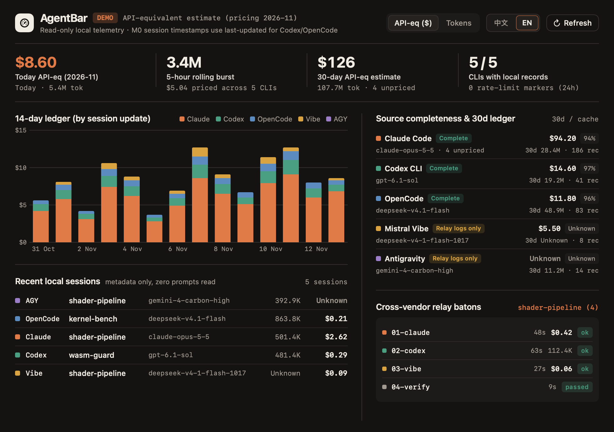

# AgentBar `v0.2.0`

**English** | **[简体中文](README.zh-CN.md)** | **[Technical Spec (`docs/SPEC.md`)](docs/SPEC.md)**

**Read-Only macOS Menu Bar & CLI Telemetry Ledger for Local Multi-Agent Workflows** (`Claude Code`, `Codex CLI`, `OpenCode`, `Mistral Vibe`, `Antigravity`, and [`agent-relay`](https://github.com/zxu756/agent-relay) `.relay/LOG.md` pipelines).

**Zero network calls · `SQLITE_OPEN_READONLY` · Zero fixed-ratio estimates · Live `中文 / EN` UI & Headless `--cli` · Zero third-party dependencies (`macOS 14.0+`)**


*`[DEMO]` Dashboard rendered from deterministic synthetic preview data (`--demo` / `--export-screenshots`), never from personal local logs.*

<p align="center">
  
  <br />
  <em><code>[DEMO]</code> Menu bar popover rendered from synthetic preview data.</em>
</p>

---

## What AgentBar Measures (and What It Does Not Guess)

Developers working across multiple coding CLIs (`claude`, `codex`, `opencode`, `vibe`, `agy`) split sessions across subscription burst windows, prepaid API credits, and file-handoff relays. **AgentBar** aggregates local telemetry strictly read-only in both a native SwiftUI menu bar app and a headless CLI (`AgentBar --cli snapshot [--json]`):

- **Deduplicated Streaming Turn Accounting (`Claude Code`)**: Deduplicates multi-block streaming JSONL lines by `(message.id, requestId)` (taking final per-turn max usage) so thinking/text/tool chunks are never double-counted.
- **Verified Rollout Breakdown (`Codex CLI`)**: Joins `threads` in `~/.codex/state_5.sqlite` with `rollout-*.jsonl` (and archived `.jsonl.zst` when `zstd` is installed) to read real uncached input, cached input, and output tokens. If a thread has no readable rollout breakdown, AgentBar reports `Total only` (`totalOnly`) and emits `null` (`Unknown`) for breakdown, cache hit rate, and cost—never fabricating fixed input/output ratios.
- **Explicit Source Completeness Badges**: Every vendor and time window (`5h`, `Today`, `7d`, `30d`) is labeled as `Complete`, `Total only`, `Relay logs only`, or `No data` (and `Refreshing…` before the initial scan completes).
- **Dated API-Equivalent Cost Conversion (`pricing 2026-11`)**: Dollar figures are labeled **`API-equivalent estimate (pricing 2026-11)`** so subscription usage (Claude Max, ChatGPT Pro/Plus) is not confused with billed invoices. Unrecognized or internal model IDs are counted separately (`unknownModelRecordCount`) instead of silently priced with a fallback model.
- **Strict `.relay/LOG.md` Baton Parser**: Parses `##` / `###` step headings (including conductor notes and multi-comma failure statuses), flushes open steps on every heading so trailing text never bleeds into an earlier step, and derives `vendor` strictly from the step heading (`NN-verify` stays `vendor: null`).
- **Live `中文 / EN` Bilingual UI & CLI**: Switch languages live via the **`中文 | EN`** header pill, `⇧⌘L`, or `--lang en|zh`.

---

## Per-CLI Data Sources & Completeness (`M0`)

| Harness | Local Files Read (`Read-Only`) | Typical Completeness | Notes & M0 Scope Boundaries |
|---|---|---|---|
| **Claude Code** | `~/.claude/projects/**/*.jsonl` (`message.id`, `requestId`, `message.usage`, `message.model`, `costUSD`, `timestamp`) | `Complete` (`complete`) | Deduplicated per `(message.id, requestId)` turn; per-turn timestamps. |
| **Codex CLI** | `~/.codex/state_5.sqlite` (`threads`) + `rollout_path` (`rollout-*.jsonl` / `.jsonl.zst`) | `Complete` (with rollout) / `Total only` (missing rollout) | Reads `token_count.info.total_token_usage`. **M0 note**: bucketed by `threads.updated_at`; per-event day bucketing is scheduled for M1. |
| **OpenCode** | `~/.local/share/opencode/opencode.db` (`session_v2`: `cost`, `tokens_*`, `model`, `time_updated`) | `Complete` (`complete`) | **M0 note**: bucketed by `session_v2.time_updated`; per-event bucketing from `message`/`part` is scheduled for M1. |
| **Mistral Vibe** | `~/Projects/*/.relay/LOG.md` (+ legacy `~/.vibe/.../meta.json` check) | `Relay logs only` (`relayOnly`) or `No data` | Current Vibe `meta.json` omits token counters (`journal/*.jsonl` parsing is scheduled for M1); never marked `Complete`. |
| **Antigravity** | `~/Projects/*/.relay/LOG.md` + `~/.gemini/antigravity-cli/log/cli-*.log` (model & `429` count only) | `Relay logs only` (`relayOnly`) or `No data` | Standalone `cli-*.log` has no token counters; `.relay/LOG.md` provides unsplit step tokens without cost guessing. |

See [`docs/SPEC.md`](docs/SPEC.md) for the exact `2026-11` pricing table, cache hit rate formula (`cache_read / (input + cache_read + cache_write)`), and JSON schema, and [`reports/m0-ledger.txt`](reports/m0-ledger.txt) for reproducible parity measurements (`2026-11-14`).

---

## Privacy & Security Architecture

1. **Zero Network Access**: `AgentBar` links only macOS system frameworks (`SwiftUI`, `Charts`, `AppKit`, `ServiceManagement`, `libsqlite3`) and contains zero `URLSession`, `NWConnection`, or `CFNetwork` symbols.
2. **Strictly Read-Only (`SQLITE_OPEN_READONLY | SQLITE_OPEN_NOMUTEX`)**: Local SQLite stores are opened read-only with a `250ms` busy timeout; running CLIs are never locked or modified.
3. **Zero Prompt Capture**: Only numeric token counters, model names, timestamps, costs, and directory basenames are inspected—prompt and reply bodies are never read into memory or printed.

---

## Install & Build

### Build from Source (macOS 14.0+, Swift 6.0+)

```bash
git clone https://github.com/zxu756/AgentBar.git
cd AgentBar
./Scripts/test.sh scope Collectors Pricing RelayLog CLI
./Scripts/build-app.sh
open build/AgentBar.app
```

### Homebrew Cask

```bash
brew install --cask zxu756/tap/agentbar
```

> Ad-hoc signed builds may prompt Gatekeeper on first launch; run `xattr -cr /Applications/AgentBar.app` if needed.

---

## Headless CLI & Verification Commands

`AgentBar` handles `--cli` before initializing `AppKit`, reading the exact same collector pipeline as the menu bar UI without opening windows or touching `~/Library/Preferences`:

```bash
# Human-readable local snapshot (English / Simplified Chinese)
build/AgentBar.app/Contents/MacOS/AgentBar --cli snapshot --lang en
build/AgentBar.app/Contents/MacOS/AgentBar --cli snapshot --lang zh

# Machine-readable JSON snapshot (with explicit nulls for unknown breakdowns)
build/AgentBar.app/Contents/MacOS/AgentBar --cli snapshot --json --lang en

# Synthetic [DEMO] snapshot & Retina screenshot export
build/AgentBar.app/Contents/MacOS/AgentBar --cli snapshot --demo --lang en
build/AgentBar.app/Contents/MacOS/AgentBar --export-screenshots docs --lang en
build/AgentBar.app/Contents/MacOS/AgentBar --export-screenshots docs --lang zh

# Run M0 acceptance ledger & README command replay
./Scripts/test.sh milestone 0
```

---

## License

MIT
