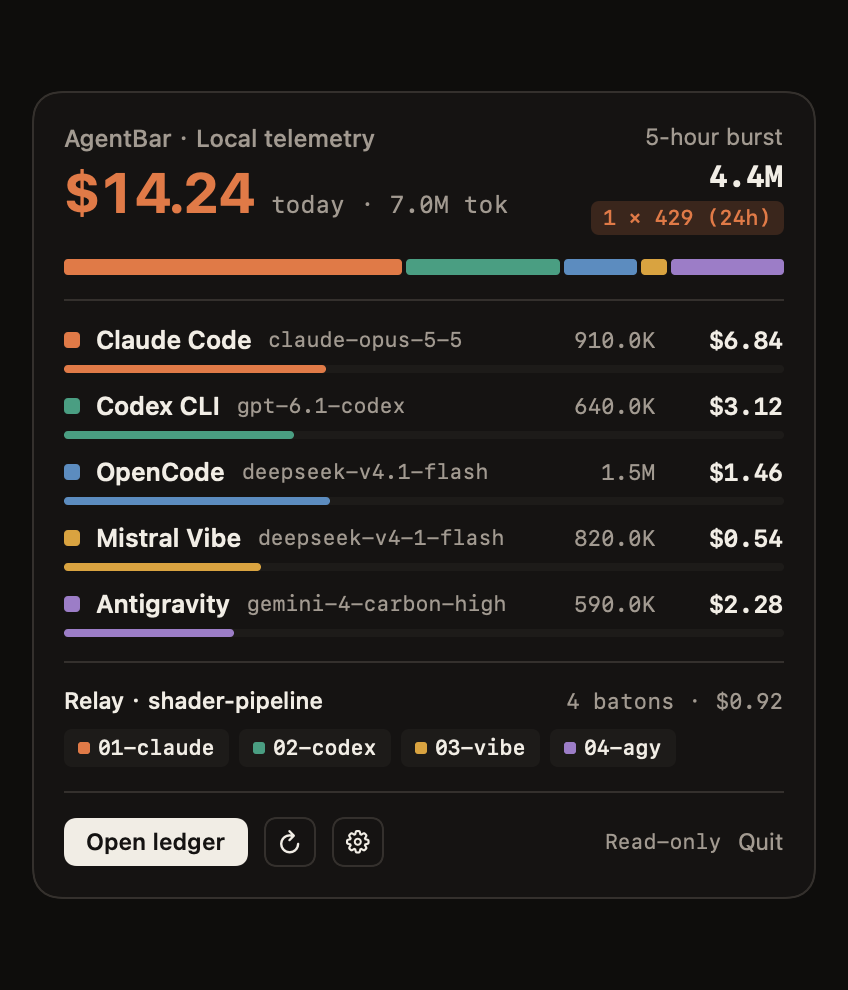

# AgentBar

**English** | **[简体中文](README.zh-CN.md)** | **[Technical Spec (`docs/SPEC.md`)](docs/SPEC.md)**

**Read-Only macOS Menu Bar & CLI Telemetry Ledger for Local Multi-Agent Workflows** (`Claude Code`, `Codex CLI`, `OpenCode`, `Mistral Vibe`, `Antigravity`, and [`agent-relay`](https://github.com/zxu756/agent-relay) `.relay/LOG.md` pipelines).

**Zero network calls · `SQLITE_OPEN_READONLY` · Zero fixed-ratio estimates · Live `中文 / EN` UI & Headless `--cli` · Zero third-party dependencies (`macOS 14.0+`)**

> **Release status (`Unreleased (after v0.2.0)`)**: Published Homebrew Cask `v0.2.0` contains the initial menu bar UI only. Headless `--cli snapshot` & `--cli daily`, `--tz` / `--home` / `--workspace` / `--now` / `--no-zstd`, `Scripts/test.sh`, five-level completeness (`complete` / `mismatch` / `totalOnly` / `relayOnly` / `noData`), per-event timestamp bucketing across `Claude` / `Codex` / `OpenCode` / `Mistral Vibe`, structured `429` rate-limit detection, explicit per-window & per-day priced-vs-excluded cost notes, and streaming deduplication are **`Unreleased (after v0.2.0)`**—build from source below to use them.


*`[DEMO]` Dashboard rendered from deterministic synthetic preview data (`--demo` / `--export-screenshots`), never from personal local logs.*

<p align="center">
  
  <br />
  <em><code>[DEMO]</code> Menu bar popover rendered from synthetic preview data.</em>
</p>

---

## What AgentBar Measures (and What It Does Not Guess)

Developers working across multiple coding CLIs (`claude`, `codex`, `opencode`, `vibe`, `agy`) split sessions across subscription burst windows, prepaid API credits, and file-handoff relays. **AgentBar** aggregates local telemetry strictly read-only in both a native SwiftUI menu bar app and a headless CLI (`AgentBar --cli snapshot|daily [--json]`, `Unreleased (after v0.2.0)`):

- **Per-Event Timestamp Attribution & `No timestamp` Isolation (`5h`, `Today`, `7d`, `14d Daily`, `30d`, `No timestamp`)**: Splits multi-day sessions into exact turn/message timestamps across `Claude Code` JSONL turns, `Codex` rollout `token_count` cumulative deltas, `OpenCode` `session_message` rows, and `Mistral Vibe` `unified/*/journal/*.jsonl` actions. Session-level timestamps (`threads.updated_at` / `session_v2.time_updated`) are used **only** for aggregate-only sessions that have zero per-event token records and a valid session timestamp; per-event records with missing or malformed timestamps (or aggregate-only sessions with missing/`0` timestamps) never fall back to `now`, session `updated_at`, or file `mtime`, contribute `0` to `5h` / `Today` / `7d` / `30d` and dated `dailyBreakdown` rows, and are tallied separately in `untimestamped` (`No timestamp` / `没有时间`).
- **Deduplicated Streaming Turn Accounting (`Claude Code`)**: Deduplicates multi-block streaming JSONL lines by `(message.id, requestId)` (taking final per-turn max usage) so thinking/text/tool chunks are never double-counted.
- **Verified Rollout Breakdown & Per-Day Mismatch Detection (`Codex CLI`)**: Joins `threads` in `~/.codex/state_5.sqlite` with full `rollout-*.jsonl` streams (and archived `.jsonl.zst` when `zstd` is installed) to compute per-turn uncached input, cached input, and output deltas, tracking mid-thread `turn_context` model switches and verifying the rollout sum against `threads.tokens_used`. If a rollout total disagrees with SQLite (`rollout != sqlite`), completeness is downgraded to `Total mismatch` (`mismatch`) with an explicit `rollout=X vs sqlite=Y` note both on the window and on every calendar day touched by that thread. If no readable rollout exists, AgentBar reports `Total only` (`totalOnly`) and emits `null` (`Unknown`) for breakdown, cache hit rate, and cost—never fabricating fixed input/output ratios.
- **Standalone `Mistral Vibe` Multi-Segment Journal Reader**: Reads `~/.vibe/logs/session/unified/<session_id>/meta.json` and ordered `journal/*.jsonl` segments, deduplicating `completion_succeeded` records by `payload.action_id`, resolving model fallbacks from `~/.vibe/config.toml`, and deduplicating `.relay/<step>.vibe/export.json` `session_id` entries against `.relay/LOG.md`.
- **Structured `429` Rate-Limit Counting**: Counts `429` hits strictly from structured status codes (`status == 429`, `http_status == 429`) and structured error payloads (`rate_limit_error`, `rate_limit_exceeded`, `isApiErrorMessage: true` + `rate_limit`), never matching `"rate"` or `"429"` substrings in free-form conversation or log prose.
- **Five-Level Source Completeness Badges**: Every vendor, time window (`5h`, `Today`, `7d`, `30d`), and 14-day daily cell is labeled `Complete`, `Total mismatch`, `Total only`, `Relay logs only`, or `No data` (and `Refreshing…` before the initial scan completes).
- **Honest API-Equivalent Cost Coverage (`rates unverified`)**: Every window and 14-day daily ledger row is labeled **`API-equivalent estimate (rates unverified; covers priced records only, unknown models excluded)`** and accompanied right beside the dollar amount by **`Covers N priced records only; M unknown-model records excluded`**. Unrecognized or internal model IDs are excluded from cost sums (`unmatchedModelCount`) instead of silently priced with a fallback model.
- **Strict `.relay/LOG.md` Baton Parser**: Parses `##` / `###` step headings (including conductor notes and multi-comma failure statuses), flushes open steps on every heading so trailing text never bleeds into an earlier step, and derives `vendor` strictly from the step heading (`NN-verify` stays `vendor: null`).
- **Live `中文 / EN` Bilingual UI & CLI**: Switch languages live via the **`中文 | EN`** header pill, `⇧⌘L`, or `--lang en|zh` (with localized Chinese data-source descriptions and labels).

---

## Per-CLI Data Sources & Completeness (`M1`)

| Harness | Local Files Read (`Read-Only`) | Typical Completeness | Per-Event Attribution & Scope Boundaries |
|---|---|---|---|
| **Claude Code** | `~/.claude/projects/**/*.jsonl` (`message.id`, `requestId`, `message.usage`, `message.model`, `costUSD`, `timestamp`, structured `error`) | `Complete` (`complete`) | Deduplicated per `(message.id, requestId)` turn; bucketed by per-turn ISO-8601 `timestamp` (missing/invalid `timestamp` -> `No timestamp`, never `now`); structured `429` only. |
| **Codex CLI** | `~/.codex/state_5.sqlite` (`threads`) + `rollout_path` (`rollout-*.jsonl` / `.jsonl.zst` full stream) | `Complete` / `Total mismatch` / `Total only` | Incremental per-turn `token_count` deltas at each event's `timestamp` + `turn_context` model tracking; cross-checks rollout sum vs `threads.tokens_used` per window & per day (`threads.updated_at` used only when rollout has `0` events and `updated_at > 0`; untimestamped rollout events -> `No timestamp`). |
| **OpenCode** | `~/.local/share/opencode/opencode.db` (`session_message` / `message` + `session_v2` fallback) | `Complete` (`complete`) | Per-message `assistant` & `compaction` rows (`time.created` / `time_created` ms, uncached `tokens.input`, `output + reasoning`, `cache.read/write`, `cost`); falls back to `session_v2` only when a session has `0` message token rows (`time_updated > 0`; missing timestamps -> `No timestamp`). |
| **Mistral Vibe** | `~/.vibe/logs/session/unified/*/journal/*.jsonl` + `meta.json` + `~/.vibe/config.toml` + `.relay/LOG.md` | `Complete` / `Relay logs only` / `Total only` / `No data` | Multi-segment `journal/*.jsonl` `completion_succeeded` deltas deduplicated by `action_id` with running Unix-ms timestamps and `.relay/*.vibe/export.json` `session_id` dedup (actions without valid preceding timestamps -> `No timestamp`; pruned pre-compaction segments are not on disk). |
| **Antigravity** | `~/Projects/*/.relay/LOG.md` + `~/.gemini/antigravity-cli/log/cli-*.log` (`cli-*.log lacks token stats`) | `Relay logs only` (`relayOnly`) or `No data` | Standalone `cli-*.log` exposes active model and timestamped structured `status=429` hits without token counters; `.relay/LOG.md` provides unsplit step tokens validated in `--tz` (missing/invalid step dates -> `No timestamp`, never marked `Complete`). |

---

## Per-Model API-Equivalent Rate Table (`PriceCatalog`, `unverified`)

Rates below were inherited without live vendor-page verification during offline M0 rework; every model prefix therefore lists its official vendor pricing URL and `unverified` verification date (see [`docs/SPEC.md`](docs/SPEC.md) for matching rules and cache-hit formula `cache_read / (input + cache_read + cache_write)`):

<details>
<summary>Show all 29 per-model rate rows (unit price per 1M tokens, official source URL, verified date)</summary>

| Model Prefix | Input / 1M | Cached Input / 1M | Cache Write / 1M | Output / 1M | Official Source URL | Verified Date |
|---|---:|---:|---:|---:|---|---|
| `claude-opus` | \$15.00 | \$1.50 | \$18.75 | \$75.00 | https://docs.anthropic.com/en/docs/about-claude/pricing | `unverified` |
| `claude-3-opus` | \$15.00 | \$1.50 | \$18.75 | \$75.00 | https://docs.anthropic.com/en/docs/about-claude/pricing | `unverified` |
| `claude-4-opus` | \$15.00 | \$1.50 | \$18.75 | \$75.00 | https://docs.anthropic.com/en/docs/about-claude/pricing | `unverified` |
| `claude-sonnet` | \$3.00 | \$0.30 | \$3.75 | \$15.00 | https://docs.anthropic.com/en/docs/about-claude/pricing | `unverified` |
| `claude-3-5-sonnet` | \$3.00 | \$0.30 | \$3.75 | \$15.00 | https://docs.anthropic.com/en/docs/about-claude/pricing | `unverified` |
| `claude-3-7-sonnet` | \$3.00 | \$0.30 | \$3.75 | \$15.00 | https://docs.anthropic.com/en/docs/about-claude/pricing | `unverified` |
| `claude-4-sonnet` | \$3.00 | \$0.30 | \$3.75 | \$15.00 | https://docs.anthropic.com/en/docs/about-claude/pricing | `unverified` |
| `claude-haiku` | \$0.80 | \$0.08 | \$1.00 | \$4.00 | https://docs.anthropic.com/en/docs/about-claude/pricing | `unverified` |
| `claude-3-haiku` | \$0.80 | \$0.08 | \$1.00 | \$4.00 | https://docs.anthropic.com/en/docs/about-claude/pricing | `unverified` |
| `claude-3-5-haiku` | \$0.80 | \$0.08 | \$1.00 | \$4.00 | https://docs.anthropic.com/en/docs/about-claude/pricing | `unverified` |
| `claude-4-haiku` | \$0.80 | \$0.08 | \$1.00 | \$4.00 | https://docs.anthropic.com/en/docs/about-claude/pricing | `unverified` |
| `gpt-6` | \$2.00 | \$0.50 | \$2.00 | \$8.00 | https://platform.openai.com/docs/pricing | `unverified` |
| `gpt-5` | \$2.00 | \$0.50 | \$2.00 | \$8.00 | https://platform.openai.com/docs/pricing | `unverified` |
| `codex-mini` | \$2.00 | \$0.50 | \$2.00 | \$8.00 | https://platform.openai.com/docs/pricing | `unverified` |
| `o3` | \$2.00 | \$0.50 | \$2.00 | \$8.00 | https://platform.openai.com/docs/pricing | `unverified` |
| `o4-mini` | \$2.00 | \$0.50 | \$2.00 | \$8.00 | https://platform.openai.com/docs/pricing | `unverified` |
| `deepseek-v4` | \$0.30 | \$0.007 | \$0.30 | \$1.20 | https://api-docs.deepseek.com/quick_start/pricing | `unverified` |
| `deepseek-v3` | \$0.30 | \$0.007 | \$0.30 | \$1.20 | https://api-docs.deepseek.com/quick_start/pricing | `unverified` |
| `deepseek-chat` | \$0.30 | \$0.007 | \$0.30 | \$1.20 | https://api-docs.deepseek.com/quick_start/pricing | `unverified` |
| `deepseek-reasoner` | \$0.30 | \$0.007 | \$0.30 | \$1.20 | https://api-docs.deepseek.com/quick_start/pricing | `unverified` |
| `gemini-4-carbon` | \$1.25 | \$0.30 | \$1.25 | \$5.00 | https://ai.google.dev/gemini-api/docs/pricing | `unverified` |
| `gemini 4 carbon` | \$1.25 | \$0.30 | \$1.25 | \$5.00 | https://ai.google.dev/gemini-api/docs/pricing | `unverified` |
| `gemini-2.5-pro` | \$1.25 | \$0.30 | \$1.25 | \$5.00 | https://ai.google.dev/gemini-api/docs/pricing | `unverified` |
| `gemini-3-pro` | \$1.25 | \$0.30 | \$1.25 | \$5.00 | https://ai.google.dev/gemini-api/docs/pricing | `unverified` |
| `gemini-4-argon` | \$0.30 | \$0.075 | \$0.30 | \$1.20 | https://ai.google.dev/gemini-api/docs/pricing | `unverified` |
| `gemini 4 argon` | \$0.30 | \$0.075 | \$0.30 | \$1.20 | https://ai.google.dev/gemini-api/docs/pricing | `unverified` |
| `gemini-2.0-flash` | \$0.30 | \$0.075 | \$0.30 | \$1.20 | https://ai.google.dev/gemini-api/docs/pricing | `unverified` |
| `gemini-2.5-flash` | \$0.30 | \$0.075 | \$0.30 | \$1.20 | https://ai.google.dev/gemini-api/docs/pricing | `unverified` |
| `gemini-3-flash` | \$0.30 | \$0.075 | \$0.30 | \$1.20 | https://ai.google.dev/gemini-api/docs/pricing | `unverified` |

</details>

---

## Privacy & Security Architecture

1. **Zero Network Access**: `AgentBar` links only macOS system frameworks (`SwiftUI`, `Charts`, `AppKit`, `ServiceManagement`, `libsqlite3`) and contains zero `URLSession`, `NWConnection`, or `CFNetwork` symbols.
2. **Strictly Read-Only (`SQLITE_OPEN_READONLY | SQLITE_OPEN_NOMUTEX`)**: Local SQLite stores are opened read-only with a `250ms` busy timeout; running CLIs are never locked or modified.
3. **In-Memory Parsing — Zero Prompt Storage or Upload**: `AgentBar` reads local transcript/session files into memory to parse JSON lines and extracts only numeric token counts, model names, timestamps, costs, and directory basenames—it never stores, displays, or uploads prompt or reply text.

---

## Install & Build

### Build from Source (macOS 14.0+, Swift 6.0+)

```bash
git clone https://github.com/zxu756/AgentBar.git
cd AgentBar
swift build
./Scripts/test.sh scope Collectors Pricing RelayLog CLI Core
./Scripts/build-app.sh
open build/AgentBar.app
```

### Homebrew Cask (`v0.2.0` — pre-M0 GUI release)

```bash
brew install --cask zxu756/tap/agentbar
```

> Ad-hoc signed builds may prompt Gatekeeper on first launch; run `xattr -cr /Applications/AgentBar.app` if needed.

---

## Headless CLI & Verification Commands (`Unreleased (after v0.2.0)`)

`AgentBar` handles `--cli` before initializing `AppKit`, reading the same collector pipeline as the menu bar UI without opening windows or touching `~/Library/Preferences`. Pass `--tz UTC` (or `--tz local` / an IANA identifier) for deterministic day boundaries across scripts. Passing a non-existent `--home <dir>` or `--workspace <dir>` exits with code `2` and an error on `stderr`; omitting `--home` scans `$HOME` and reports `No data` for uninstalled CLIs:

```bash
# CLI usage help (English / Simplified Chinese)
.build/debug/AgentBar --help --lang en
.build/debug/AgentBar --help --lang zh

# Human-readable local snapshot (English / Simplified Chinese)
.build/debug/AgentBar --cli snapshot --lang en
.build/debug/AgentBar --cli snapshot --lang zh

# 14-day per-event daily ledger with per-day priced/excluded & mismatch notes (UTC)
.build/debug/AgentBar --cli daily --tz UTC --lang en
.build/debug/AgentBar --cli daily --tz UTC --lang zh

# Machine-readable JSON snapshot (schemaVersion 1.1, explicit nulls & 14-day dailyBreakdown)
.build/debug/AgentBar --cli snapshot --json --tz UTC --lang en
.build/debug/AgentBar --cli snapshot --json --tz UTC --lang zh

# Synthetic [DEMO] snapshot & Retina screenshot export
.build/debug/AgentBar --cli snapshot --demo --lang en
.build/debug/AgentBar --cli snapshot --demo --lang zh
.build/debug/AgentBar --export-screenshots /tmp/agentbar-screenshots --lang en
.build/debug/AgentBar --export-screenshots /tmp/agentbar-screenshots --lang zh

# Run M0 & M1 acceptance ledgers & README command replay
./Scripts/test.sh milestone 0
./Scripts/test.sh milestone 1
```

---

## License

MIT
