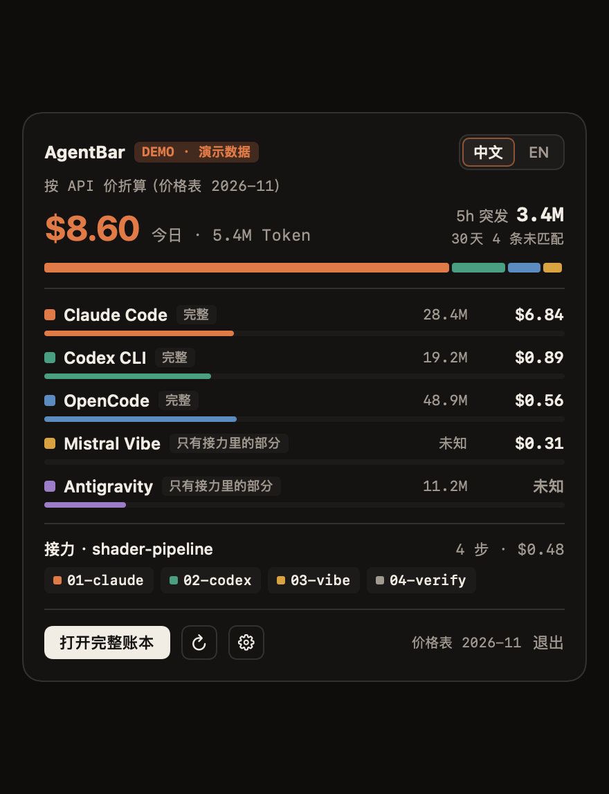

# AgentBar `v0.2.0`

**[English](README.md)** | **简体中文** | **[技术规范 (`docs/SPEC.md`)](docs/SPEC.md)**

**面向多智能体编程工作流的 macOS 原生只读菜单栏与命令行遥测账本**（支持 `Claude Code`、`Codex CLI`、`OpenCode`、`Mistral Vibe`、`Antigravity` 及 [`agent-relay`](https://github.com/zxu756/agent-relay) `.relay/LOG.md` 接力流水线）。

**零网络请求 · `SQLITE_OPEN_READONLY` 严格只读 · 零固定比例估算 · 实时 `中文 / EN` 双语界面与无头 `--cli` · 零第三方依赖 (`macOS 14.0+`)**


*`[DEMO / 演示数据]` 上图由确定性合成预览数据（`--demo` / `--export-screenshots`）渲染生成，绝不包含任何个人真实本地日志。*

<p align="center">
  
  <br />
  <em><code>[DEMO / 演示数据]</code> 菜单栏弹窗合成预览截图。</em>
</p>

---

## AgentBar 统计什么（以及绝不猜测什么）

同时使用多款本地 AI 编程 CLI（`claude`、`codex`、`opencode`、`vibe`、`agy`）时，用量分散在包月滚动窗口、API 预付额度与多工具文件接力记录中。**AgentBar** 通过原生菜单栏界面与无头命令行（`AgentBar --cli snapshot [--json]`）以严格只读方式汇总本地真实记录：

- **流式内容块去重统计（`Claude Code`）**：按 `(message.id, requestId)` 对同一轮回复的多条流式块（`thinking`、`text`、`tool_use`）去重并取最终最大用量，消除多块重复累加。
- **真实 Rollout 明细读取（`Codex CLI`）**：将 `~/.codex/state_5.sqlite` 的 `threads` 表与 `rollout-*.jsonl`（及归档 `.jsonl.zst`，需本机装有 `zstd`）关联，提取真实未缓存输入、缓存读取与输出 Token。若某线程缺少可读 rollout 明细，则诚实标记为 `只有总量`（`totalOnly`），明细、缓存命中率与费用均输出 `null`（界面显示 `未知`），绝不用固定比例拆分伪造。
- **四级数据源完整度标签**：每个厂商与时间窗口（`最近 5 小时`、`今天`、`7 天`、`30 天`）均明确标注 `完整`、`只有总量`、`只有接力里的部分` 或 `没有数据`（首次扫描完成前显示 `刷新中…`）。
- **带日期版本的 API 等效折算（`价格表 2026-11`）**：所有估算金额统一标注 **`按 API 价折算（价格表 2026-11）`**，区分订阅制（Claude Max、ChatGPT Pro/Plus）与实际账单；未收录或内部模型标识单独计入 `unknownModelRecordCount`（未匹配模型记录数），绝不静默套用其他模型单价。
- **严格 `.relay/LOG.md` 接力解析**：完整识别 `##` / `###` 步骤标题（含 conductor 会话内记录及带逗号的失败状态），遇到任何标题立即闭合上一步防止正文串行，且仅从步骤标题提取 `vendor`（如 `NN-verify` 保持 `vendor: null`）。
- **实时 `中文 / EN` 双语切换**：支持顶栏 **`中文 | EN`** 胶囊、快捷键 `⇧⌘L` 以及命令行 `--lang zh|en`。

---

## 各 CLI 数据源与完整度说明（`M0`）

| CLI 工具 | 本地只读数据源 | 典型完整度 | 口径说明与 M0 边界 |
|---|---|---|---|
| **Claude Code** | `~/.claude/projects/**/*.jsonl`（`message.id`、`requestId`、`message.usage`、`message.model`、`costUSD`、`timestamp`） | `完整` (`complete`) | 按 `(message.id, requestId)` 单轮去重；按单轮时间戳归桶。 |
| **Codex CLI** | `~/.codex/state_5.sqlite` (`threads`) + `rollout_path` (`rollout-*.jsonl` / `.jsonl.zst`) | `完整`（有 rollout）/ `只有总量`（缺 rollout） | 读取 `token_count.info.total_token_usage`。**M0 口径**：当前按 `threads.updated_at` 会话最后更新时间归桶；逐事件跨天归桶排在 M1。 |
| **OpenCode** | `~/.local/share/opencode/opencode.db`（`session_v2`：`cost`、`tokens_*`、`model`、`time_updated`） | `完整` (`complete`) | **M0 口径**：当前按 `session_v2.time_updated` 会话最后更新时间归桶；从 `message`/`part` 逐事件归桶排在 M1。 |
| **Mistral Vibe** | `~/Projects/*/.relay/LOG.md`（兼容检查旧版 `~/.vibe/.../meta.json`） | `只有接力里的部分` (`relayOnly`) 或 `没有数据` | 当前版本 Vibe 的 `meta.json` 不含 Token 字段（`journal/*.jsonl` 解析排在 M1）；绝不标为 `完整`。 |
| **Antigravity** | `~/Projects/*/.relay/LOG.md` + `~/.gemini/antigravity-cli/log/cli-*.log`（仅模型名与 `429` 计数） | `只有接力里的部分` (`relayOnly`) 或 `没有数据` | 独立 `cli-*.log` 不含 Token 用量；仅汇总 `.relay/LOG.md` 中的步骤总 Token，不猜测未拆分费用。 |

完整的 `2026-11` 价格表、缓存命中率公式（`cache_read / (input + cache_read + cache_write)`）及 JSON 字段定义见 [`docs/SPEC.md`](docs/SPEC.md)；本机独立对账输出（测量日期 `2026-11-14`）见 [`reports/m0-ledger.txt`](reports/m0-ledger.txt)。

---

## 隐私与安全架构

1. **零网络访问**：仅链接 macOS 系统框架（`SwiftUI`、`Charts`、`AppKit`、`ServiceManagement`、`libsqlite3`），二进制不含任何 `URLSession`、`NWConnection` 或 `CFNetwork` 符号。
2. **严格只读 (`SQLITE_OPEN_READONLY | SQLITE_OPEN_NOMUTEX`)**：以只读模式及 `250ms` 忙等待超时读取本地 SQLite，绝不锁死或修改正在运行的 CLI。
3. **零提示词读取**：仅解析数值型计数器、模型名称、时间戳、费用与目录名，绝不读取或输出任何提示词与对话正文。

---

## 安装与源码构建

### 从源码编译（需 macOS 14.0+、Swift 6.0+）

```bash
git clone https://github.com/zxu756/AgentBar.git
cd AgentBar
./Scripts/test.sh scope Collectors Pricing RelayLog CLI
./Scripts/build-app.sh
open build/AgentBar.app
```

### Homebrew Cask 安装

```bash
brew install --cask zxu756/tap/agentbar
```

> 发布包采用本地 ad-hoc 签名，首次启动如遇 Gatekeeper 提示，可执行 `xattr -cr /Applications/AgentBar.app`。

---

## 无头命令行（Headless CLI）与验收复现

`AgentBar` 在进入 `AppKit` 事件循环前处理 `--cli`，与菜单栏界面共用同一套采集函数，不弹窗、不写 `~/Library/Preferences`：

```bash
# 人类可读本地快照（简体中文 / 英文）
build/AgentBar.app/Contents/MacOS/AgentBar --cli snapshot --lang zh
build/AgentBar.app/Contents/MacOS/AgentBar --cli snapshot --lang en

# 机器可读 JSON 快照（未知明细严格输出 null）
build/AgentBar.app/Contents/MacOS/AgentBar --cli snapshot --json --lang zh

# 合成演示数据快照与 2x Retina 双语截图导出
build/AgentBar.app/Contents/MacOS/AgentBar --cli snapshot --demo --lang zh
build/AgentBar.app/Contents/MacOS/AgentBar --export-screenshots docs --lang en
build/AgentBar.app/Contents/MacOS/AgentBar --export-screenshots docs --lang zh

# 运行 M0 独立对账验收与 README 命令回放
./Scripts/test.sh milestone 0
```

---

## 开源协议

MIT
