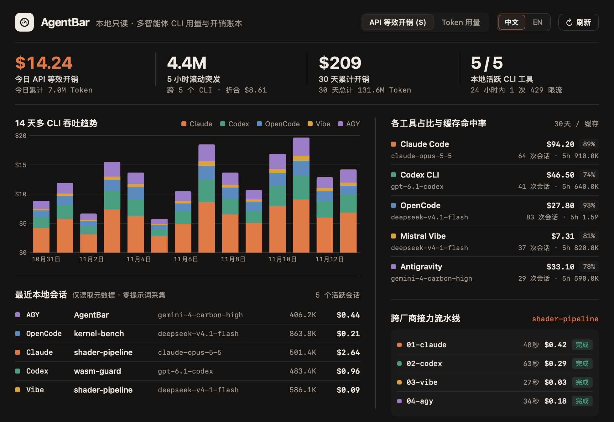

# AgentBar `v0.2.0`

**[English](README.md)** | **简体中文**

**面向多智能体编程工作流的 macOS 原生菜单栏与 Swift Charts 本地遥测账本**（原生支持 `Claude Code`、`Codex CLI`、`OpenCode`、`Mistral Vibe`、`Antigravity` 以及 [`agent-relay`](https://github.com/zxu756/agent-relay) 多工具接力流水线）。

**零网络请求 · `SQLITE_OPEN_READONLY` 严格只读 · 界面内实时 `中文 / EN` 双语切换 · 零第三方依赖 · 纯 SwiftPM 构建 (`macOS 14.0+`)**



<p align="center">
  
</p>

---

## 为什么需要 AgentBar？

同时使用多款现代 AI 编程 CLI（`claude`、`codex`、`opencode`、`vibe`、`agy`）的开发者，往往将任务拆分在包月 5 小时滚动额度窗口、按量预付 API 额度与无头多智能体文件接力流水线之间——但真实的 Token 消耗与开销却散落在彼此不兼容的本地 SQLite 数据库、JSONL 会话日志与 `.relay/LOG.md` 交接记录中。

**AgentBar `v0.2.0`** 将五大主流 CLI 工具整合进仅约 1.5 MB 的原生 SwiftUI + Swift Charts 仪表盘，常驻于 macOS 菜单栏：

- **多 CLI 比例能耗条**：一眼看清今日在 Claude Code、Codex CLI、OpenCode、Mistral Vibe 与 Antigravity 上的 API 等效美元开销与 Token 占比。
- **5 小时滚动突发仪表**：实时追踪每个 CLI 的 5 小时滚动 Token 吞吐速率，以及过去 24 小时内的 HTTP `429` / `RESOURCE_EXHAUSTED` 限流次数。
- **14 天堆叠吞吐趋势图 (`Swift Charts`)**：一键在「每日 API 等效开销 ($)」与「百万 Token 吞吐量」之间切换。
- **提示词缓存命中率核算**：按 CLI 精确计算真实缓存读取命中率（`cache_read / (input + cache_read + cache_write)`）。
- **原生 [`agent-relay`](https://github.com/zxu756/agent-relay) 接力检查器**：自动扫描 `<工作区>/*/.relay/LOG.md` 接力记录，呈现每一棒耗时、模型名称、单棒开销与完成/告警状态。
- **应用内实时 `中文 / EN` 双语切换 (`v0.2.0`)**：首次启动自动识别简体中文 macOS 系统环境；主账本顶栏与菜单栏弹窗顶栏均内置 **`中文 | EN`** 分段切换胶囊，支持菜单快捷键 `⇧⌘L`（`切换语言 / Toggle Language`）及命令行 `--lang zh|en` 参数覆盖。

---

## 隐私与安全架构

不同于索要浏览器会话 Cookie、OAuth 令牌或 API 密钥的 Electron 面板或云端中转服务：

1. **零网络访问**：`AgentBar` 从不引入 `URLSession`，也不开启任何网络套接字，所有数据永不离开你的 Mac。
2. **严格只读 (`SQLITE_OPEN_READONLY | SQLITE_OPEN_NOMUTEX`)**：以只读模式及 `250ms` 忙等待超时读取本地 SQLite 数据库（`~/.codex/state_5.sqlite`、`~/.local/share/opencode/opencode.db`），绝不锁死或修改正在运行的 CLI。
3. **仅提取元数据，绝不读取提示词正文**：JSONL 与 SQLite 采集器仅读取数值型 Token 计数、`cost`、`model` 标识、时间戳与项目目录名——提示词与模型回复正文从不载入内存。

| CLI 工具 | 本地只读遥测数据源 |
|---|---|
| **Claude Code** | `~/.claude/projects/*/*.jsonl` (`message.usage`、`message.model`、`costUSD`、`timestamp`) |
| **Codex CLI** | `~/.codex/state_5.sqlite` (`threads`：`tokens_used`、`model`、`updated_at`、`cwd`) |
| **OpenCode** | `~/.local/share/opencode/opencode.db` (`session_v2`：`cost`、`tokens_*`、`model`、`time_updated`) |
| **Mistral Vibe** | `~/.vibe/logs/session/unified/*/meta.json` + `.relay/LOG.md` 接力记录 |
| **Antigravity** | `~/.gemini/antigravity-cli/log/cli-*.log` (`label="..."` 活跃模型与 `429` 标记) + `.relay/LOG.md` |
| **agent-relay** | `~/Projects/*/.relay/LOG.md` (`## NN-agent` 步骤标题、耗时、开销、Token 数) |

---

## 安装指南 (`v0.2.0`)

### Homebrew Cask 安装（推荐）

```bash
brew install --cask zxu756/tap/agentbar
```

> 由于发布包采用本地 ad-hoc 签名而非付费 Apple Developer ID 公证，首次打开如遇 Gatekeeper 提示，可执行一次 `xattr -cr /Applications/AgentBar.app`。

### 从源码编译（零 `.xcodeproj` 工程文件）

需要 macOS 14.0+（Sonoma 或更新版本）以及 Swift 6.0+ / Command Line Tools：

```bash
git clone https://github.com/zxu756/AgentBar.git
cd AgentBar
swift test --no-parallel
./Scripts/build-app.sh
open build/AgentBar.app
```

命令行语言与截图导出参数：

```bash
# 指定启动语言（覆盖 UserDefaults 与系统语言）
build/AgentBar.app/Contents/MacOS/AgentBar --lang zh
build/AgentBar.app/Contents/MacOS/AgentBar --lang en

# 导出 2x Retina 中英文宣传截图
build/AgentBar.app/Contents/MacOS/AgentBar --export-screenshots docs --lang zh
```

---

## 开源协议

MIT
